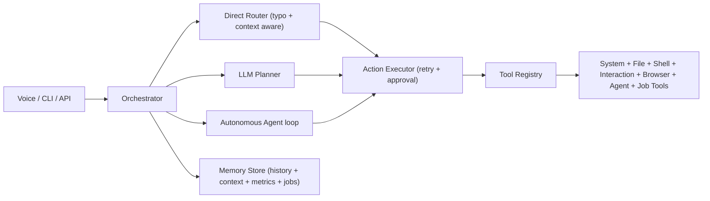

# JARVIS (Voice + Desktop + Browser Automation)

JARVIS is a local automation assistant built with `Python + FastAPI + CLI/Voice + tool-based execution`.
It supports system commands, file actions, desktop automation, browser control (YouTube/WhatsApp), an
autonomous plan→execute→observe→re-plan agent, and config-driven job-application automation.

## What’s Improved

This version adds all requested upgrades across five phases:

1. **Playwright-first browser control** for YouTube + WhatsApp (with keyboard fallback).
2. **Typo-tolerant router** for noisy voice/text inputs.
3. **Desktop/Start Menu shortcut discovery** tools.
4. **Reliability layer**: tool retries, execution metadata, rotating logs, WAL-backed SQLite, VAD voice gating.
5. **Runtime context memory** (`active_surface`) for follow-up commands like `next`.
6. **Evaluation metrics dashboard** (latency, success/failure rates, top failing tools).
7. **Security hardening**: `API_TOKEN` auth, rate limiting, CORS, and a hardened shell policy.
8. **Autonomous agent loop** (`agent_done`, iteration/action caps, double-failure stop, approval handoff).
9. **Job-application automation**: search top job boards, auto-fill forms, upload a PDF resume, auto-submit,
   with a per-site selector config and a dedupe/audit trail.

## Quick Start (Windows)

1. Install dependencies:
```powershell
.\scripts\bootstrap.ps1
```
All versions live in `pyproject.toml`; `requirements.txt` is a thin `-e .[dev]` shim so `bootstrap.ps1` stays simple.

2. Install Playwright browser runtime (required for full browser automation):
```powershell
.\.venv\Scripts\playwright install chromium
```

3. Copy `.env.example` to `.env`, then set at minimum:
- `LLM_PROVIDER=openai` + `OPENAI_API_KEY=...`
- or `LLM_PROVIDER=groq` + `GROQ_API_KEY=...`
- or `LLM_PROVIDER=ollama` (with Ollama running)

4. Run JARVIS (desktop HUD with the embedded web deck — no browser needed):
```powershell
.\scripts\run_jarvis.ps1
```

Optional — standalone API server for LAN/phone access:
```powershell
.\scripts\run_jarvis.ps1 -Api
```

Optional — interactive text CLI (voice device diagnostics, approvals, metrics):
```powershell
.\scripts\run_jarvis.ps1 -Cli   # or: python -m app.cli
```

## Auto-Start

The HUD can start itself automatically in two places:

- **VS Code**: opening this folder runs a `folderOpen` task (`.vscode/tasks.json`) that launches the HUD.
- **Windows login**: a `JARVIS Auto Start` shortcut in the Startup folder launches the HUD.

Turn it off/on anytime:

- Click the **AUTOSTART ON / AUTOSTART OFF** chip in the HUD top bar, or
- `.\scripts\auto_start.ps1 off` / `on` / `status`

Disabled = the HUD does not auto-start until you re-enable it (manual `run_jarvis.ps1` always works).

## Dashboard extras

- **Smart alerts** — a beep + toast in the corner of the HUD whenever a command fails, an approval is waiting, the job agent pauses, or the bot hits an error. Click the toast to jump to the HUD.
- **HELP panel** — click the **HELP** chip for an in-app list of every command and tool (built from the live tool registry).
- **Minimize to tray** — click the **TRAY** chip to hide the HUD into the system tray (JARVIS icon). Right-click the icon for *Show HUD / Mini window / Exit*.
- **Summon hotkey** — press `Ctrl+Shift+J` anywhere in Windows to pop up the floating mini HUD on demand.
- **RECAP** — click the **RECAP** chip (or just start JARVIS after being away) for a "while you were away" catch-up review: commands run, tool activity, job pipeline moves, and scheduled runs since your last session.

## Autonomous agent upgrades

- **Live agent feed** — the HUD feed streams each agent step (planning, tool selection, tool results) in real time while the agent works, so you can watch what it is doing.
- **`read_webpage`** — the agent can open any URL and read the page text, so it can browse a site and reason about what it finds instead of only acting on it.
- **Learned memory** — JARVIS remembers what it learns about you across runs (frequently opened apps, last WhatsApp contact) and injects it into the planner prompt as *known facts* plus a *tool history* recap so it stops repeating itself.
- **Approve-and-continue** — when a risky step needs your sign-off, JARVIS now *waits* for you instead of giving up: click **APPROVE** or **REJECT** on the HUD (or use the CLI/API) and the agent resumes the exact step where it stopped.
- **Job resume + pipeline** — after the job agent pauses on a login/CAPTCHA wall, click **RESUME** on the HUD to continue from the exact page it stopped on. Track your pipeline with `job status`/`job update status <url> <status>` — statuses roll up into APPLIED / INTERVIEW / OFFER / REJECTED counters on the HUD.
- **Scheduler** — say or type `schedule <command> daily at 09:00` (also `hourly`, `every N minutes`, `weekly on <day> at HH:MM`). `list_schedules` shows the queue, `cancel_schedule <id>` removes one. Each run appears in the HUD feed.

## Embedded Web Deck

The full animated dashboard now lives **inside** the HUD window — click the **DECK** chip to open it (WebView2/Chromium, no browser needed). It runs the same FastAPI engine in-process, sharing one runtime.

- **Live feed** — run commands from the glowing command bar; agent steps, approvals, job updates, and scheduler runs stream in over a WebSocket.
- **Voice panel** — start/stop the voice engine with an animated waveform.
- **Approvals** — approve/reject risky agent steps from cards.
- **Jobs** — apply form, live task status with progress, APPLIED/INTERVIEW/OFFER/REJECTED pipeline counters, RESUME/CANCEL.
- **Scheduler** — create/list/cancel recurring commands with the same syntax as the CLI/voice tools.
- **Always-on status bar** — CPU / GPU / RAM / disk ring meters + sparkline history (GPU read in-process via Windows PDH counters, works on Intel UHD).
- **Themes & perf** — cycle three themes (Aurora / Cyber / Light); **Lite graphics mode is the default** (battery-friendly, static aurora + few particles) with a Full mode toggle. Animations run at ~30 fps and fully pause when the tab is hidden.
- **Video backgrounds** — click the **◳** button: keep the animated aurora canvas, paste any looping video URL (galaxy, anime, nature…), or drop a `.mp4` into `data/backgrounds/` and pick it from the list (served locally at `/backgrounds/…`). A dim + blur overlay keeps the UI readable; the video pauses when the tab is hidden.
- **Security** — first launch asks for your `API_TOKEN` (saved in `localStorage`); auto-connects if auth is disabled.

The HUD, mini-window, tray, and hotkey are unchanged and work alongside the deck.

## Architecture



## Core Direct Commands

### Browser / Media
- `play <query> on youtube`
- `youtube play <query>`
- `youtube pause`, `youtube resume`
- `youtube next`, `youtube previous`
- `youtube skip 30`, `youtube rewind 20`
- `youtube seek 1:25`
- `youtube jump to 50%`
- `send whatsapp to <phone>: <message>`
- `open whatsapp chat <phone>: <message>`

### Context-Aware Follow-Ups
If your active surface is YouTube, these work directly:
- `next`, `previous`, `pause`, `resume`
- `skip 20`, `rewind 10`
- `seek 2:30`

### Autonomous Agent
Commands that start with research/investigate/figure out/troubleshoot/diagnose/set up/automate/build me/
scan/audit/monitor/analyze/check if run through the multi-iteration agent loop instead of a single plan.

### Job Automation
- `apply for <query>` — search configured job boards and apply automatically (pauses on login/CAPTCHA; RESUME on the HUD continues from the paused page).
- `job status` — current task status, phase, progress, and counters.
- `job applied` — audit trail of applications (dedupe across runs).
- `job cancel` — stop the running task.
- `job resume` — continue a paused task from where it stopped.
- `job update status <url> <status>` — mark an application as e.g. `interview` / `offer` / `rejected` (rolls up into the HUD pipeline counters).

### Discovery / Desktop
- `list shortcuts`
- `list apps`
- `open shortcut <name>`
- `open <app>`
- `close <app>`

### System / Files / Shell
- `system status`
- `list processes`
- `find files <pattern>`
- `read file <path>`
- `move file <src> -> <dst>`
- `run <powershell command>` (allowlist + approval policy)
- `take screenshot`

### Runtime Quality / Dashboard
- `metrics`
- `show dashboard`

## Job Automation Setup

1. Edit `config/job_profile.yaml` with your real identity, skills, work history, and form-field answers.
2. Edit `config/site_profiles.yaml` to enable/disable boards and fix selectors if a site's DOM changes.
3. Set `JOB_TARGET_SITES=linkedin,indeed,...` and `RESUME_PDF=data/resume/CV.pdf` in `.env`.
4. Run: `apply for python developer` (or `POST /v1/job/apply`).

Behavior notes:
- The agent skips jobs already applied to (URL dedupe in SQLite).
- `JOB_MAX_APPLY_PER_RUN` caps submissions per run; `JOB_APPLY_REMOTE_ONLY=true` only applies to remote roles.
- It pauses (and records `paused_reason`) on CAPTCHAs and login walls — it never bypasses CAPTCHAs.
- Uses one persistent Playwright profile (`BROWSER_PROFILE_DIR`), so you can pre-login once.

> **Terms of service caveat**: auto-applying (e.g. LinkedIn Easy Apply) can violate a job site's ToS.
> Keep `JOB_USE_BURNER_ACCOUNT=true` and use a throwaway account; run at modest volume.

## Voice Mode Notes

- Wake word: `jarvis`
- Follow-up window: after a wake-word command, short commands can run without repeating wake word (configurable).
- WhatsApp voice safety: by default, voice sends are staged first; say `confirm send` to send, or `cancel`.

Voice diagnostics in CLI:
- `/voice status`
- `/voice test`
- `/voice probe`
- `/voice devices`
- `/voice outputs`

## API Endpoints

- `GET /v1/health`
- `GET /v1/tools`
- `POST /v1/execute`
- `GET /v1/pending-approvals`
- `POST /v1/approve/{approval_id}`
- `GET /v1/history`
- `GET /v1/history/tools`
- `GET /v1/metrics`
- `POST /v1/voice/start`
- `POST /v1/voice/stop`
- `POST /v1/job/apply`
- `GET /v1/job/task`
- `POST /v1/job/cancel`
- `GET /v1/job/applied`
- `POST /v1/reject/{approval_id}`
- `GET /v1/schedules` · `POST /v1/schedules` · `DELETE /v1/schedules/{id}`
- `GET /v1/resources`
- `POST /v1/job/resume`
- `GET /v1/backgrounds` · `GET /backgrounds/{name}` — list + serve local background videos from `data/backgrounds/`
- `WS /ws/events` — live event stream (`?token=` for auth) with topics: `command_start`, `command_done`, `agent_step`, `scheduler_run`, `approval`

All endpoints except `/v1/health` require `Authorization: Bearer <API_TOKEN>` and are rate limited.

Example:
```bash
curl -X POST http://localhost:8000/v1/execute \
  -H "Authorization: Bearer $JARVIS_TOKEN" \
  -H "Content-Type: application/json" \
  -d "{\"command\":\"play lofi focus on youtube\",\"source\":\"api\",\"auto_approve\":false}"
```

## CLI Helpers

- `/help`
- `/pending`
- `/approve <id>`
- `/reject <id>`
- `/metrics [limit]`
- `/quit`

## Desktop GUI

`scripts\run_jarvis.ps1` opens the JARVIS command HUD (`app/gui.py`):

- **Command bar** with ↑/↓ history + `EXECUTE` button, plus quick preset chips (Play/Pause, Next, Apps, MINI, TRAY, RECAP)
- **Live terminal + activity feed** — responses, tool statuses, and a scrolling ✓/⏳/✗ command feed (agent steps stream in live)
- **Voice engine** with a state-aware wave (LISTENING / PROCESSING / ATTENTION / IDLE) and start/stop toggle
- **Job agent panel** — live status (phase, applied/skipped/failed, pause reason) with APPLY / STATUS / CANCEL / RESUME and APPLIED / INTERVIEW / OFFER / REJECTED pipeline counters
- **Approvals panel** with APPROVE / REJECT, **AI Bot chat**, **app launcher** (Alt+1..9), **resource meters** (CPU/RAM/network), scene viewer

**Mini floating window** (`app/minihud.py`):
- While you work elsewhere, a small always-on-top window shows live activity (current/last command, result status, voice state, CPU/RAM bars) and a quick-command box.
- Drag it anywhere; it auto-pops when you run a command and its position is remembered between runs.

## Optimization

Three opt-in features keep JARVIS fast and cheap:

- **LLM result cache** — planner output is stored in SQLite keyed by normalized command, so repeating a
  command ("system status", "play lofi on youtube") skips the LLM call entirely and answers instantly.
  Toggle with `LLM_CACHE_ENABLED` (default `true`); tune `LLM_CACHE_TTL_DAYS` and `LLM_CACHE_MAX_ENTRIES`.
  Only the plan is cached — every command still executes its tools each time.
- **Model tiering** — route routine planning to a fast/cheap model and the autonomous-agent loop to a
  bigger one. Set `AGENT_LLM_PROVIDER` (empty = same as `LLM_PROVIDER`) plus the matching
  `AGENT_OPENAI_MODEL` / `AGENT_GROQ_MODEL` / `AGENT_OLLAMA_MODEL`.
- **LiteLLM gateway** — optional multi-provider routing/fallback. Install with
  `pip install -e .[litellm]`, set `LLM_PROVIDER=litellm` and `LITELLM_MODEL=groq/llama-3.3-70b-versatile`
  (provider-prefixed names), optionally `LITELLM_API_BASE` / `LITELLM_API_KEY`.

## Important Config Knobs (`.env`)

- `API_TOKEN` — bearer token required for API calls
- `CORS_ALLOWED_ORIGINS` — comma-separated allowed origins
- `APPROVAL_POLICY`, `AUTO_APPROVE_LOW_RISK`
- `ALLOWED_SHELL_COMMANDS`, `ALLOWED_ROOTS`
- `DB_RETENTION_DAYS`
- `AGENT_MAX_ITERATIONS`, `AGENT_ACTION_CAP`, `AGENT_APPROVAL_POLICY`
- `JOB_TARGET_SITES`, `JOB_MAX_APPLY_PER_RUN`, `JOB_APPLY_REMOTE_ONLY`, `JOB_USE_BURNER_ACCOUNT`
- `JOB_PROFILE`, `JOB_SITE_PROFILES`, `RESUME_PDF`
- `VOICE_FOLLOWUP_WINDOW_SECONDS`, `VOICE_CONFIRM_BEFORE_SEND`
- `TOOL_RETRY_ATTEMPTS`, `TOOL_RETRY_BACKOFF_SECONDS`
- `BROWSER_PROFILE_DIR`, `BROWSER_AUTOMATION_TIMEOUT_MS`

## Safety Model

- Approval policy supports: `none`, `high_only`, `medium_and_high`, `all`.
- Shell commands are prefix-allowlisted and reject compound/pipe operators, destructive patterns,
  and obfuscated execution (`-EncodedCommand`, `Invoke-Expression`, `Bypass`, etc.).
- Protected OS processes are blocked from termination.
- File tools obey safe-root restrictions.
- The job agent never bypasses CAPTCHAs and pauses on login walls.

## Troubleshooting

1. **YouTube/WhatsApp control opens but doesn’t automate**
   - Install Playwright browser runtime: `playwright install chromium`
   - Retry command; fallback mode may still work with keyboard focus.

2. **WhatsApp doesn’t auto-send**
   - Ensure WhatsApp Web is logged in.
   - In voice mode, confirm flow needs `confirm send`.

3. **Job agent gets stuck or pauses**
   - Check `job status` / `GET /v1/job/task` for `paused_reason` (login/CAPTCHA).
   - Pre-login in the persistent browser profile, then re-run.
   - If a site’s selectors changed, update `config/site_profiles.yaml`.

4. **Voice feels slow**
   - Lower `SPEECH_AMBIENT_ADJUST_INTERVAL_SECONDS`
   - Tune `SPEECH_TIMEOUT_SECONDS` and `PHRASE_TIME_LIMIT_SECONDS`.

5. **Command not recognized due spelling/noise**
   - Use `/metrics` and inspect recent command failures.
   - Add aliases in `app/core/router.py` (`_WORD_ALIASES`).

## Testing

```bash
python -m pytest -q
ruff check app tests
mypy app tests
```

## Project Structure

```text
app/
  agents/
    job_agent.py          # autonomous job search + apply workflow
  bootstrap.py            # runtime assembly (registry, agent, job agent, voice)
  main.py                 # FastAPI app + job/voice/metrics routes
  cli.py
  gui.py                  # tkinter command HUD (dashboard)
  minihud.py              # draggable always-on-top mini window
  config.py               # env-driven settings
  core/
    agent.py              # plan->execute->observe->re-plan loop
    approvals.py
    executor.py
    memory.py             # SQLite history, context, metrics, jobs_applied
    monitor.py            # psutil resource metrics
    orchestrator.py
    prompts.py
    router.py
  llm/
    planner.py
  tools/
    agent_tools.py        # agent_done
    browser_action.py     # reusable browser DSL
    browser_session.py    # shared persistent Playwright session
    browser_tools.py
    file_tools.py
    interaction_tools.py
    job_tools.py
    metrics_tools.py
    shell_tools.py
    system_tools.py
    registry.py
  voice/
    listener.py
    speaker.py
    loop.py
config/
  job_profile.yaml        # your identity/skills/form answers
  site_profiles.yaml      # job-board search + selector profiles
tests/
scripts/                # run_jarvis.ps1 (single launcher) + bootstrap + clean + auto_start
```

## Maintenance

- `.\scripts\clean.ps1` removes generated caches (`__pycache__`, pytest/ruff caches) and prunes
  Chromium profile cache folders — it keeps your saved logins in `data/browser_profile`.
- `data/`, `logs/`, and `.venv/` are gitignored runtime state.
