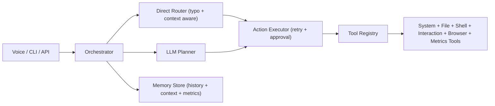

# JARVIS (Voice + Desktop + Browser Automation)

JARVIS is a local automation assistant built with `Python + FastAPI + CLI/Voice + tool-based execution`.
It supports system commands, file actions, desktop automation, and now stronger YouTube/WhatsApp control.

## What’s Improved

This version adds all 7 requested upgrades:

1. **Playwright-first browser control** for YouTube + WhatsApp (with keyboard fallback).
2. **Typo-tolerant router** for noisy voice/text inputs.
3. **Desktop/Start Menu shortcut discovery** tools.
4. **Reliability layer** with tool retries + execution metadata.
5. **Runtime context memory** (`active_surface`) for follow-up commands like `next`.
6. **Evaluation metrics dashboard** (latency, success/failure rates, top failing tools).
7. **Voice UX upgrades**: wake-word follow-up window + safe WhatsApp send confirmation flow.

## Quick Start (Windows)

1. Install dependencies:
```powershell
.\scripts\bootstrap.ps1
```

2. Install Playwright browser runtime (required for full browser automation):
```powershell
.\.venv\Scripts\playwright install chromium
```

3. Copy `.env.example` to `.env`, then set at minimum:
- `LLM_PROVIDER=openai` + `OPENAI_API_KEY=...`
- or `LLM_PROVIDER=groq` + `GROQ_API_KEY=...`
- or `LLM_PROVIDER=ollama` (with Ollama running)

4. Run API:
```powershell
.\scripts\run_api.ps1
```

5. Run CLI:
```powershell
.\scripts\run_cli.ps1
```

If PowerShell policy blocks scripts:
```cmd
scripts\run_cli.cmd
```

6. Run Desktop GUI popup:
```powershell
.\scripts\run_gui.ps1
```
Fallback (CMD):
```cmd
scripts\run_gui.cmd
```

## One-Command Start

Use this single command to start Jarvis popup:
```powershell
.\scripts\start_jarvis.ps1
```

With voice auto-start:
```powershell
.\scripts\start_jarvis.ps1 voice
```

CMD fallback:
```cmd
scripts\start_jarvis.cmd
scripts\start_jarvis.cmd voice
```

## Architecture



## Core Direct Commands

### Browser / Media
- `play <query> on youtube`
- `youtube play <query>`
- `youtube pause`, `youtube resume`
- `youtube next`, `youtube previous`
- `youtube skip 30`, `youtube rewind 20`
- `youtube seek 1:25`
- `youtube jump to 50%`
- `send whatsapp to <phone>: <message>`
- `open whatsapp chat <phone>: <message>`

### Context-Aware Follow-Ups
If your active surface is YouTube, these work directly:
- `next`, `previous`, `pause`, `resume`
- `skip 20`, `rewind 10`
- `seek 2:30`

### Discovery / Desktop
- `list shortcuts`
- `list apps`
- `open shortcut <name>`
- `open <app>`
- `close <app>`

### System / Files / Shell
- `system status`
- `list processes`
- `find files <pattern>`
- `read file <path>`
- `move file <src> -> <dst>`
- `run <powershell command>` (allowlist + approval policy)
- `take screenshot`

### Runtime Quality / Dashboard
- `metrics`
- `show dashboard`

## Voice Mode Notes

- Wake word: `jarvis`
- Follow-up window: after a wake-word command, short commands can run without repeating wake word (configurable).
- WhatsApp voice safety: by default, voice sends are staged first; say `confirm send` to send, or `cancel`.

Voice diagnostics in CLI:
- `/voice status`
- `/voice test`
- `/voice probe`
- `/voice devices`
- `/voice outputs`

## API Endpoints

- `GET /v1/health`
- `GET /v1/tools`
- `POST /v1/execute`
- `GET /v1/pending-approvals`
- `POST /v1/approve/{approval_id}`
- `GET /v1/history`
- `GET /v1/history/tools`
- `GET /v1/metrics`
- `POST /v1/voice/start`
- `POST /v1/voice/stop`

Example:
```bash
curl -X POST http://localhost:8000/v1/execute \
  -H "Content-Type: application/json" \
  -d "{\"command\":\"play lofi focus on youtube\",\"source\":\"api\",\"auto_approve\":false}"
```

## CLI Helpers

- `/help`
- `/pending`
- `/approve <id>`
- `/metrics [limit]`
- `/quit`

## Desktop GUI

When you run `run_gui.ps1`, a Jarvis popup opens with:
- Command box + `Run` button
- Voice `Start/Stop` toggle
- Quick action buttons (YouTube, Apps, Shortcuts, Metrics)
- Output panel (responses + tool statuses)
- Pending approvals panel with `Refresh` and `Approve Selected`

This gives you direct laptop control without typing in terminal each time.

## Important Config Knobs (`.env`)

- `VOICE_FOLLOWUP_WINDOW_SECONDS`
- `VOICE_CONFIRM_BEFORE_SEND`
- `SPEECH_AMBIENT_ADJUST_DURATION_SECONDS`
- `SPEECH_AMBIENT_ADJUST_INTERVAL_SECONDS`
- `TOOL_RETRY_ATTEMPTS`
- `TOOL_RETRY_BACKOFF_SECONDS`
- `BROWSER_PROFILE_DIR`
- `BROWSER_AUTOMATION_TIMEOUT_MS`
- `APPROVAL_POLICY`
- `ALLOWED_SHELL_COMMANDS`

## Safety Model

- Approval policy supports: `none`, `high_only`, `medium_and_high`, `all`.
- Shell commands are prefix-allowlisted.
- Protected OS processes are blocked from termination.
- File tools obey safe-root restrictions.

## Troubleshooting

1. **YouTube/WhatsApp control opens but doesn’t automate**
   - Install Playwright browser runtime: `playwright install chromium`
   - Retry command; fallback mode may still work with keyboard focus.

2. **WhatsApp doesn’t auto-send**
   - Ensure WhatsApp Web is logged in.
   - In voice mode, confirm flow needs `confirm send`.

3. **Voice feels slow**
   - Lower `SPEECH_AMBIENT_ADJUST_INTERVAL_SECONDS`
   - Tune `SPEECH_TIMEOUT_SECONDS` and `PHRASE_TIME_LIMIT_SECONDS`.

4. **Command not recognized due spelling/noise**
   - Use `/metrics` and inspect recent command failures.
   - Add aliases in `app/core/router.py` (`_WORD_ALIASES`).

## Project Structure

```text
app/
  bootstrap.py
  main.py
  cli.py
  config.py
  core/
    approvals.py
    executor.py
    memory.py
    orchestrator.py
    prompts.py
    router.py
  llm/
    planner.py
  tools/
    browser_tools.py
    file_tools.py
    interaction_tools.py
    metrics_tools.py
    shell_tools.py
    system_tools.py
    registry.py
  voice/
    listener.py
    speaker.py
    loop.py
tests/
scripts/
```
